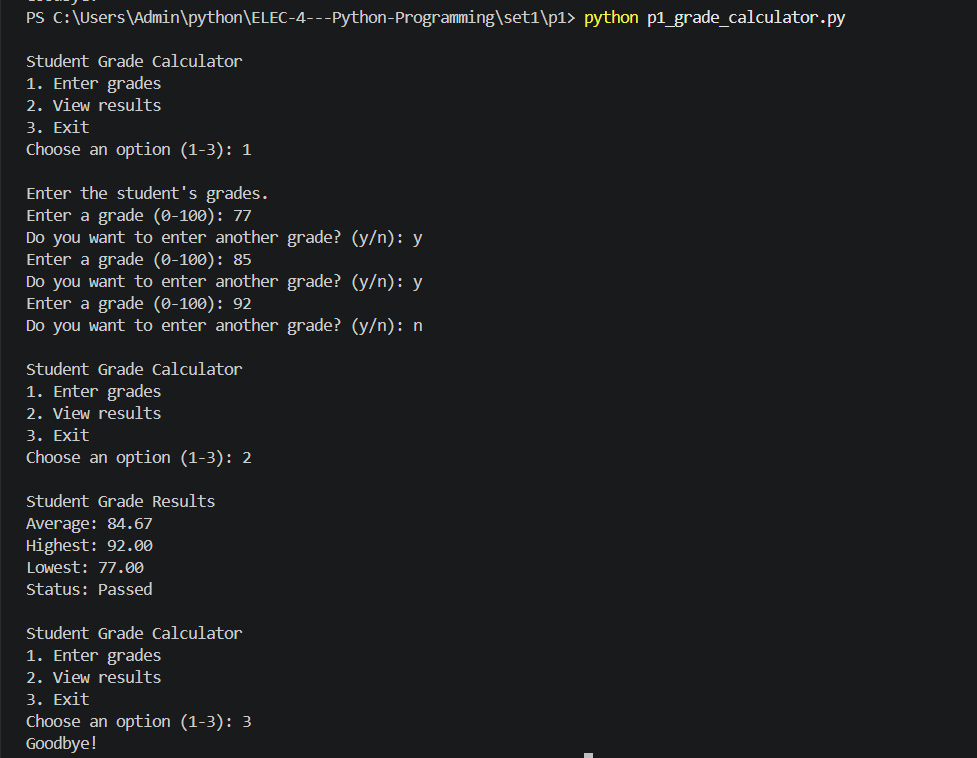

# ELEC 4 – Python Programming
### Self-Paced Learning Assignment

**Name:** Noel Jake Bernal  
**Section:** IV-BSIT A  
**Course:** ELEC 4 – Python Programming  
**Instructor:** Carl Gustaf Patrik B. Ferrer  

---

## 📌 About This Repository

This repository contains my laboratory outputs for the ELEC 4 – Python Programming Self-Paced Learning Assignment. The activities demonstrate understanding of Python programming concepts, including functions, modular programming, collections, exception handling, file input/output, recursion, classes and objects, inheritance, and polymorphism.

---

## 📋 Activities Summary

### SET 1 – Python Fundamentals (Deadline: Nov 29, 2026, 11:59 PM)

| Activity | Description | Main File | Folder |
|---|---|---|---|
| **P1** | Student Grade Calculator – User-defined functions & variable scope | `p1_grade_calculator.py` | [📂 P1](set1/p1/) |
| **P2** | Custom Module – `student_utils.py` and built-in modules | `p2_main.py` | [📂 P2](set1/p2/) |
| **P3** | Student Record Manager – Lists, sets & duplicate prevention | `p3_record_manager.py` | [📂 P3](set1/p3/) |
| **P4** | Safe Menu Program – Exception handling (`try-except-else-finally`) | `p4_exceptions.py` | [📂 P4](set1/p4/) |

### SET 2 – Advanced Python Concepts (Deadline: Dec 6, 2026, 11:59 PM)

| Activity | Description | Main File | Folder |
|---|---|---|---|
| **P5** | Student Information File System – File storage in `students.txt` | `p5_file_system.py` | [📂 P5](set2/p5/) |
| **P6** | Recursion Toolkit – Recursive calculations and search | `p6_recursion.py` | [📂 P6](set2/p6/) |
| **P7** | Student Management System – Classes, `__init__`, and private attributes | `p7_classes.py` | [📂 P7](set2/p7/) |
| **P8** | Inheritance & Polymorphism – Base/derived classes & method overriding | `p8_inheritance.py` | [📂 P8](set2/p8/) |

---

## 🚀 How to Run & Sample Outputs

### Set 1 Activities

#### P1: Student Grade Calculator
* **Directory:** `set1/p1/`
* **File:** `p1_grade_calculator.py`
* **Run command:**
  ```bash
  # Option 1: Navigate to directory
  cd set1/p1
  python p1_grade_calculator.py

  # Option 2: Run directly from repository root
  python set1/p1/p1_grade_calculator.py
  ```
* **Sample Output:**
  

---

#### P2: Custom Module (`student_utils`)
* **Directory:** `set1/p2/`
* **Files:** `p2_main.py`, `student_utils.py`
* **Run command:**
  ```bash
  # Option 1: Navigate to directory
  cd set1/p2
  python p2_main.py

  # Option 2: Run directly from repository root
  python set1/p2/p2_main.py
  ```
* **Sample Output:**
  

---

#### P3: Student Record Manager
* **Directory:** `set1/p3/`
* **File:** `p3_record_manager.py`
* **Run command:**
  ```bash
  # Option 1: Navigate to directory
  cd set1/p3
  python p3_record_manager.py

  # Option 2: Run directly from repository root
  python set1/p3/p3_record_manager.py
  ```
* **Sample Output:**
  

---

#### P4: Safe Menu Program
* **Directory:** `set1/p4/`
* **File:** `p4_exceptions.py`
* **Run command:**
  ```bash
  # Option 1: Navigate to directory
  cd set1/p4
  python p4_exceptions.py

  # Option 2: Run directly from repository root
  python set1/p4/p4_exceptions.py
  ```
* **Sample Output:**
  

---

### Set 2 Activities

#### P5: Student Information File System
* **Directory:** `set2/p5/`
* **Files:** `p5_file_system.py`, `students.txt`
* **Run command:**
  ```bash
  # Option 1: Navigate to directory
  cd set2/p5
  python p5_file_system.py

  # Option 2: Run directly from repository root
  python set2/p5/p5_file_system.py
  ```
* **Sample Output:**
  

---

#### P6: Recursion Toolkit
* **Directory:** `set2/p6/`
* **File:** `p6_recursion.py`
* **Run command:**
  ```bash
  # Option 1: Navigate to directory
  cd set2/p6
  python p6_recursion.py

  # Option 2: Run directly from repository root
  python set2/p6/p6_recursion.py
  ```
* **Sample Output:**
  

---

#### P7: Student Management System with Classes
* **Directory:** `set2/p7/`
* **File:** `p7_classes.py`
* **Run command:**
  ```bash
  # Option 1: Navigate to directory
  cd set2/p7
  python p7_classes.py

  # Option 2: Run directly from repository root
  python set2/p7/p7_classes.py
  ```
* **Sample Output:**
  

---

#### P8: Inheritance and Polymorphism
* **Directory:** `set2/p8/`
* **File:** `p8_inheritance.py`
* **Run command:**
  ```bash
  # Option 1: Navigate to directory
  cd set2/p8
  python p8_inheritance.py

  # Option 2: Run directly from repository root
  python set2/p8/p8_inheritance.py
  ```
* **Sample Output:**
  
