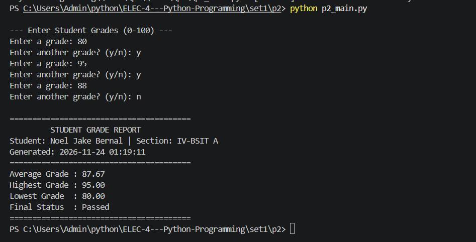

# ELEC 4 – Python Programming
### Self-Paced Learning Assignment

**Name:** Noel Jake Bernal  
**Section:** IV-BSIT A  
**Course:** ELEC 4 – Python Programming  
**Instructor:** Carl Gustaf Patrik B. Ferrer  

---

## 📌 About This Repository

This repository contains my laboratory outputs for the ELEC 4 – Python Programming Self-Paced Learning Assignment. The activities demonstrate understanding of Python programming concepts, including functions, modular programming, collections, exception handling, file input/output, recursion, classes and objects, inheritance, and polymorphism.

---

## 📋 Activities Summary

### SET 1 – Python Fundamentals (Deadline: Nov 29, 2026, 11:59 PM)

| Activity | Description | Folder |
|---|---|---|
| **P1** | Student Grade Calculator – User-defined functions, parameters, return values, variable scope | [📂 P1](set1/p1/) |
| **P2** | Custom Module – `student_utils.py` and built-in modules (`datetime`) | [📂 P2](set1/p2/) |
| **P3** | Student Record Manager – Lists, sets, and case-insensitive duplicate prevention | [📂 P3](set1/p3/) |
| **P4** | Safe Menu Program – Exception handling with `try`, `except`, `else`, and `finally` | [📂 P4](set1/p4/) |

### SET 2 – Advanced Python Concepts (Deadline: Dec 6, 2026, 11:59 PM)

| Activity | Description | Folder |
|---|---|---|
| **P5** | Student Information File System – Persistent storage in `students.txt` with `with open()` | [📂 P5](set2/p5/) |
| **P6** | Recursion Toolkit – Pure recursive functions (factorial, fibonacci, sum, search) | [📂 P6](set2/p6/) |
| **P7** | Student Management System – Classes, `__init__`, private attributes, and validation | [📂 P7](set2/p7/) |
| **P8** | Inheritance & Polymorphism – Base and derived classes with method overriding | [📂 P8](set2/p8/) |

---

## 🚀 How to Run & Sample Outputs

### Set 1 Activities

#### P1: Student Grade Calculator
* **Run command:**
  ```bash
  python set1/p1/p1_grade_calculator.py
  ```
* **Sample Output:**
  

---

#### P2: Custom Module (`student_utils`)
* **Run command:**
  ```bash
  python set1/p2/p2_main.py
  ```
* **Sample Output:**
  

---

#### P3: Student Record Manager
* **Run command:**
  ```bash
  python set1/p3/p3_record_manager.py
  ```
* **Sample Output:**
  

---

#### P4: Safe Menu Program
* **Run command:**
  ```bash
  python set1/p4/p4_exceptions.py
  ```
* **Sample Output:**
  

---

### Set 2 Activities

#### P5: Student Information File System
* **Run command:**
  ```bash
  python set2/p5/p5_file_system.py
  ```
* **Sample Output:**
  

---

#### P6: Recursion Toolkit
* **Run command:**
  ```bash
  python set2/p6/p6_recursion.py
  ```
* **Sample Output:**
  

---

#### P7: Student Management System with Classes
* **Run command:**
  ```bash
  python set2/p7/p7_classes.py
  ```
* **Sample Output:**
  

---

#### P8: Inheritance and Polymorphism
* **Run command:**
  ```bash
  python set2/p8/p8_inheritance.py
  ```
* **Sample Output:**
  
